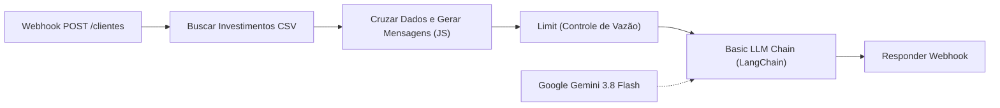
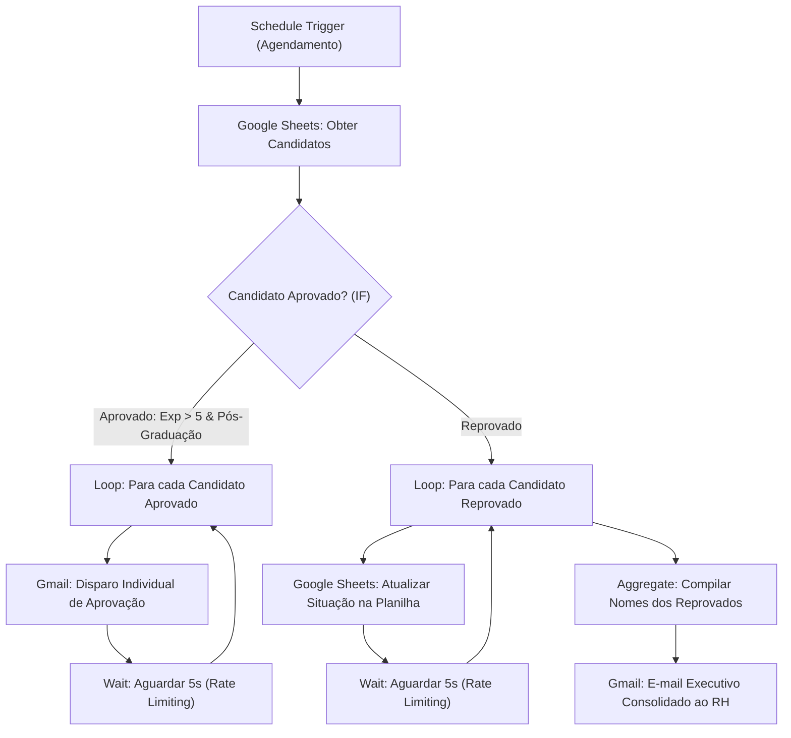
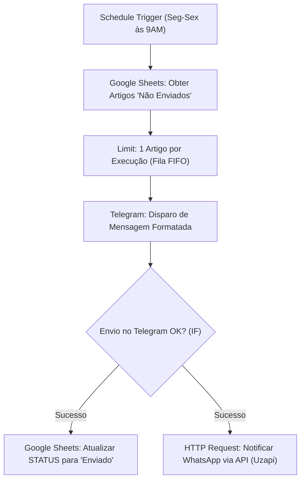
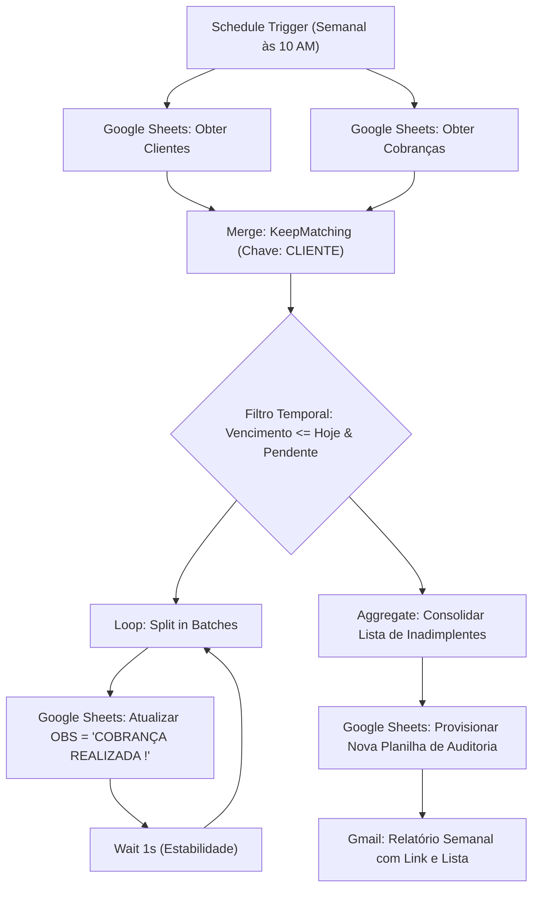

# 🚀 Automação de Processos com n8n & Inteligência Artificial
### Formação Santander 2026 — Digital Innovation One (DIO)


Repositório estruturado contendo os fluxos de trabalho (workflows) desenvolvidos, testados e homologados durante o bootcamp **Santander 2026 - Automação com n8n**, realizado em parceria com a **Digital Innovation One (DIO)**.

O projeto reúne pipelines completos de automação corporativa, cobrindo cenários reais de **Recursos Humanos**, **Mercado Financeiro / Wealth Management**, **Comunicação Multicanal (Omnichannel)** e **Gestão Financeira & Cobrança**, integrando nós de lógica avançada, APIs RESTful, webhooks, serviços do Google Workspace e agentes inteligentes baseados em **Inteligência Artificial Generativa (LLMs via LangChain e Google Gemini)**.

---

## 📑 Sumário

- [Visão Geral das Tecnologias](#-visão-geral-das-tecnologias)
- [Estrutura do Repositório](#-estrutura-do-repositório)
- [Detalhamento dos Workflows Desenvolvidos](#-detalhamento-dos-workflows-desenvolvidos)
  - [1. Assistente de Investimentos com IA & RPA](#1-assistente-de-investimentos-com-ia--rpa)
  - [2. Triagem e Automação de Processos Seletivos (RH)](#2-triagem-e-automação-de-processos-seletivos-rh)
  - [3. Sistema de Notificações Multicanal (Telegram & WhatsApp)](#3-sistema-de-notificações-multicanal-telegram--whatsapp)
  - [4. Gestão Semanal de Inadimplência e Cobrança Automatizada](#4-gestão-semanal-de-inadimplência-e-cobrança-automatizada)
- [Certificados de Conclusão](#-certificados-de-conclusão)
- [Como Importar e Executar no seu n8n](#-como-importar-e-executar-no-seu-n8n)
- [Segurança & Boas Práticas](#-segurança--boas-práticas)
- [Autor & Contato](#-autor--contato)

---

## 🛠 Visão Geral das Tecnologias

Neste programa de capacitação intensiva, foram explorados conceitos de ponta em engenharia de automação low-code/code:

- **Plataforma Core**: [n8n](https://n8n.io/) (Community & Enterprise Workflows).
- **Inteligência Artificial & Agentes**: nós de `@n8n/n8n-nodes-langchain`, `chainLlm`, `lmChatGoogleGemini` com modelos `Google Gemini 3.8 Flash` e Engenharia de Prompts contextuais.
- **Protocolos & Conectividade**: Webhooks síncronos com resposta dinâmica (`Respond to Webhook`), requisições HTTP REST (cabeçalhos, payloads dinâmicos, autenticação Bearer Token).
- **Manipulação de Dados & Lógica**: Nós de Código em JavaScript (ES6+), filtragem avançada, loops controlados (`SplitInBatches`), rate-limiting defensivo (`Wait`), junção relacional em memória (`Merge - KeepMatching`) e consolidação de arrays (`Aggregate`).
- **Serviços Integrados**: Google Sheets, Google Drive, Gmail, Telegram Bot API e API de mensageria WhatsApp (Uzapi).

---

## 📂 Estrutura do Repositório

```text
├── .gitignore
├── README.md
├── workflows/
│   ├── 01-assistente-investimentos-ia-rpa.json
│   ├── 02-triagem-processos-seletivos.json
│   ├── 03-notificacoes-telegram-whatsapp.json
│   └── 04-cobrancas-semanal-gsheets-gmail.json
└── certificados/
    ├── CERTIFICADO - Santander 2026 - Automação com N8N.pdf
    ├── Automatizando Processos com N8N.pdf
    ├── Criando um Processo de RPA com N8N e Python.pdf
    ├── Criação de Workflows Simples no N8N.pdf
    ├── DIO Agente - Nunca Mais Estude Sozinho.pdf
    ├── Fundamento da IA Moderna Machine Learnig -  LLMs -  IA Generativa e Agentes.pdf
    ├── Integração com Serviços Populares no N8N.pdf
    ├── Introdução à Engenharia de Prompts.pdf
    ├── Manupulação de Dados e Variáveis no N8N.pdf
    ├── Navegação e Interface do N8N.pdf
    ├── Planejando Automações com N8N usando apenas Bons Prompts.pdf
    ├── Potencializando Seus Estudos e Carreira com IA (Chatbots, Copilotos e Agentes).pdf
    ├── Primeiros Passos com N8N - Conceitos e Instalação.pdf
    ├── Treinando uma IA de Aprendizagem - Explore o Poder do NotebookLM.pdf
    ├── Uso de Webhoos e APIs no N8N.pdf
    └── Utilizando Nós Padrão do N8N.pdf
```

---

## 🧩 Detalhamento dos Workflows Desenvolvidos

Abaixo está o descritivo completo de cada um dos quatro fluxos desenvolvidos, destacando o problema de negócio abordado, a arquitetura da solução e os seus principais diferenciais técnicos.

---

### 1. Assistente de Investimentos com IA & RPA

📁 **Arquivo:** [`workflows/01-assistente-investimentos-ia-rpa.json`](workflows/01-assistente-investimentos-ia-rpa.json)



#### 🎯 O Problema que Resolve
No setor financeiro e de wealth management, analisar manualmente o perfil de tolerância a risco (Conservador, Moderado, Arrojado) de múltiplos clientes e cruzar com um portfólio dinâmico de produtos de investimento consome horas de trabalho dos assessores. Além disso, comunicações genéricas geram baixo engajamento e conversão de aportes.

#### ⚙️ Como o Fluxo Resolve o Problema
1. **Entrada Instantânea (Webhook):** Um nó de Webhook síncrono recebe o payload com a lista de clientes (nome, e-mail, saldo disponível e perfil de risco).
2. **Coleta Externa de Portfólio (HTTP Request):** O fluxo efetua um download em tempo real de uma base atualizada de produtos de investimento (CSV público no GitHub).
3. **Tratamento e Cruzamento de Dados (Code / JavaScript):** Processa o CSV, normaliza rentabilidades e aportes mínimos e filtra apenas as aplicações condizentes com o perfil de cada cliente.
4. **Hiperpersonalização com Inteligência Artificial (LangChain + Gemini):** Passa as informações consolidadas por um nó de LLM (`Google Gemini 3.8 Flash`) orientado por engenharia de prompts rigorosa, gerando um texto humanizado, consultivo e persuasivo adaptado à realidade daquele cliente.
5. **Retorno Síncrono (Respond to Webhook):** Retorna o resultado final diretamente na resposta HTTP para o sistema solicitante (ex.: app bancário ou CRM).

#### 🌟 Pontos Fortes e Diferenciais Técnicos
- **Agente de IA Integrado:** Não se limita a concatenar templates estáticos; utiliza LLM generativa de última geração para atuar como um consultor financeiro sob medida.
- **Arquitetura Event-Driven:** Execução sob demanda em tempo real via Webhook com nó `Respond to Webhook`.
- **Processamento de Alto Desempenho em JavaScript:** Higienização e matching relacional direto na camada de execução do n8n sem depender de banco de dados intermediário.
- **Governança de Custos e Cotas:** Nó `Limit` embutido para controle do lote enviado à API da LLM, prevenindo estouro de limites de tokens.

---

### 2. Triagem e Automação de Processos Seletivos (RH)

📁 **Arquivo:** [`workflows/02-triagem-processos-seletivos.json`](workflows/02-triagem-processos-seletivos.json)



#### 🎯 O Problema que Resolve
Processos seletivos com alto volume de inscrições sofrem com lentidão na fase inicial de triagem de currículos, demora no retorno aos candidatos e sobrecarga da equipe de recrutamento na atualização de planilhas de controle.

#### ⚙️ Como o Fluxo Resolve o Problema
1. **Acionamento Programado (Schedule Trigger):** O workflow é ativado automaticamente em data e horário previamente definidos para rodar o ciclo de triagem.
2. **Leitura da Base de Candidatos:** Conecta-se à planilha do **Google Sheets** que reúne os dados dos inscritos.
3. **Avaliação Automatizada por Regra de Negócio (IF):** Valida os critérios eliminatórios simultâneos (`Anos de Experiência > 5` **E** `Nível de Escolaridade == 'Pós-Graduação'`).
4. **Trilha dos Aprovados:**
   - Itera candidato por candidato com `Split in Batches`.
   - Envia um e-mail de congratulações personalizado pelo **Gmail**, chamando o candidato pelo primeiro nome.
   - Aplica um nó de espera de 5 segundos (`Wait`) entre cada envio.
5. **Trilha dos Reprovados:**
   - Itera com `Split in Batches` e atualiza a situação do candidato para `"Reprovado (a)"` diretamente na planilha original via `appendOrUpdate`.
   - Ao concluir as atualizações, o nó `Aggregate` consolida os nomes de todos os reprovados em um vetor único.
   - Dispara um único e-mail com relatório sintético para a liderança de RH (`rh@gmail.com`).

#### 🌟 Pontos Fortes e Diferenciais Técnicos
- **Proteção contra Bloqueios (Rate-Limiting):** Uso estratégico de `Split in Batches` combinado a nós `Wait` de 5s, respeitando as políticas de envio e cotas das APIs do Google (Gmail e Sheets).
- **Sincronização Bidirecional (Single Source of Truth):** Mantém a base do Google Sheets rigorosamente atualizada em tempo real.
- **Comunicação Não-Poluidora:** Ao invés de disparar dezenas de notificações individuais sobre candidatos não qualificados, o nó `Aggregate` cria um sumário executivo único para a equipe de recrutamento.

---

### 3. Sistema de Notificações Multicanal (Telegram & WhatsApp)

📁 **Arquivo:** [`workflows/03-notificacoes-telegram-whatsapp.json`](workflows/03-notificacoes-telegram-whatsapp.json)



#### 🎯 O Problema que Resolve
A publicação diária de notícias, artigos técnicos e comunicados corporativos em múltiplos canais de comunicação exige tempo, é suscetível a erros humanos (links quebrados, duplicidade de envios) e descontinuidade do cronograma editorial.

#### ⚙️ Como o Fluxo Resolve o Problema
1. **Disparo Diário Programado:** Executa de segunda a sexta-feira, pontualmente às 9h da manhã.
2. **Consulta com Filtro em Fonte de Dados:** Lê uma planilha no Google Sheets filtrando exclusivamente registros cujo campo `STATUS` seja `"Não Enviado"`.
3. **Controle de Cadência (Limit):** Isola o primeiro registro pendente, assegurando a entrega de exatamente 1 artigo por dia útil (fila sequencial FIFO).
4. **Publicação no Telegram:** Monta a mensagem estruturada em Markdown enriquecido (título em negrito, descrição e link) e envia para o canal do Telegram via bot.
5. **Checagem de Integridade (IF):** Verifica se a resposta da API do Telegram confirmou a entrega (`ok == true`).
6. **Disparo Simultâneo e Atualização:**
   - Marca a linha correspondente como `"Enviado"` no Google Sheets usando o `row_number` como identificador de precisão.
   - Efetua uma chamada REST via `HTTP Request` para a API do WhatsApp (Uzapi) entregando o conteúdo diretamente no WhatsApp do destinatário.

#### 🌟 Pontos Fortes e Diferenciais Técnicos
- **Estratégia Omnichannel Coordenada:** Disparo sincronizado em dois dos mensageiros mais populares do mercado (Telegram e WhatsApp) a partir de um único ponto de verdade.
- **Idempotência e Garantia de Não-Duplicação:** A planilha só é atualizada se a primeira entrega tiver sucesso comprovado, evitando mensagens perdidas em caso de falha de conexão.
- **Consumo de API REST Externa Customizada:** Emprega o nó `HTTP Request` com cabeçalhos de autenticação Bearer, especificação de payload JSON dinâmico e mapeamento de dados entre nós.

---

### 4. Gestão Semanal de Inadimplência e Cobrança Automatizada

📁 **Arquivo:** [`workflows/04-cobrancas-semanal-gsheets-gmail.json`](workflows/04-cobrancas-semanal-gsheets-gmail.json)



#### 🎯 O Problema que Resolve
O monitoramento de títulos a vencer e vencidos armazenados em planilhas separadas (dados cadastrais de clientes vs. títulos financeiros) costuma gerar atrasos na cobrança, retrabalho em conciliação e perda de receita por falta de cobrança oportuna.

#### ⚙️ Como o Fluxo Resolve o Problema
1. **Agendamento Recorrente:** Ativado semanalmente às 10h da manhã via `Schedule Trigger`.
2. **Leitura Paralela de Duas Bases Distintas:**
   - Base 1: Cadastro de Clientes no Google Sheets.
   - Base 2: Tabela de Cobranças e Vencimentos no Google Sheets.
3. **Junção Relacional em Memória (Merge):** Realiza uma operação análoga a um `INNER JOIN` conectando as duas bases pela chave comum `"CLIENTE"`.
4. **Filtro Temporal Dinâmico:** Avalia através de expressões de data (`$today.format('yyyy-MM-dd')`) os títulos vencidos até a data corrente que ainda não foram marcados com `"COBRANÇA REALIZADA !"`.
5. **Bifurcação Paralela e Governança:**
   - **Branch de Atualização:** Itera cada registro pendente e atualiza o status para `"COBRANÇA REALIZADA !"` na planilha original, mantendo 1 segundo de intervalo entre requisições.
   - **Branch de Consolidação e Auditoria:** O nó `Aggregate` reúne todos os nomes com pendência, aciona o nó do Google Sheets para **criar uma nova planilha de revisão nomeada dinamicamente** (`Revisao_Cobrancas_AAAA-MM-DD`) e dispara um e-mail HTML via **Gmail** para o setor de cobrança contendo o link do documento criado e a relação de clientes notificados.

#### 🌟 Pontos Fortes e Diferenciais Técnicos
- **Operação de JOIN sem Banco Relacional:** Executa mesclagem de datasets no próprio motor do n8n através do nó `Merge` em modo `combine / keepMatching`.
- **Criação Dinâmica de Recursos no Google Drive:** Cria novos arquivos em tempo de execução para servir de trilha de auditoria para equipes contábeis e financeiras.
- **Expressões de Data com Moment/Luxon:** Regras de negócio que independem de datas estáticas, calculando prazos dinamicamente no momento da execução.

---

## 🏆 Certificados de Conclusão

Todos os certificados conquistados ao longo da formação Santander 2026 / DIO encontram-se digitalizados em alta resolução no diretório [`certificados/`](certificados/).

### 🎓 Certificado Principal da Formação
| Certificado | Emissor | Carga / Ano | Documento |
|:---|:---:|:---:|:---:|
| **Bootcamp Santander 2026 - Automação com N8N** | **Santander / DIO** | **2026** | [Visualizar Certificado Oficial](certificados/CERTIFICADO%20-%20Santander%202026%20-%20Automa%C3%A7%C3%A3o%20com%20N8N.pdf) |

### 📚 Certificações Modulares de Especialização

| Categoria | Módulo / Curso | Arquivo PDF |
|:---|:---|:---:|
| **Fundamentos & Arquitetura n8n** | Primeiros Passos com N8N - Conceitos e Instalação | [Visualizar](certificados/Primeiros%20Passos%20com%20N8N%20-%20Conceitos%20e%20Instala%C3%A7%C3%A3o.pdf) |
| **Fundamentos & Arquitetura n8n** | Navegação e Interface do N8N | [Visualizar](certificados/Navega%C3%A7%C3%A3o%20e%20Interface%20do%20N8N.pdf) |
| **Fundamentos & Arquitetura n8n** | Criação de Workflows Simples no N8N | [Visualizar](certificados/Cria%C3%A7%C3%A3o%20de%20Workflows%20Simples%20no%20N8N.pdf) |
| **Nós, Dados e Variáveis** | Utilizando Nós Padrão do N8N | [Visualizar](certificados/Utilizando%20N%C3%B3s%20Padr%C3%A3o%20do%20N8N.pdf) |
| **Nós, Dados e Variáveis** | Manipulação de Dados e Variáveis no N8N | [Visualizar](certificados/Manupula%C3%A7%C3%A3o%20de%20Dados%20e%20Vari%C3%A1veis%20no%20N8N.pdf) |
| **APIs, Webhooks & Integrações** | Uso de Webhooks e APIs no N8N | [Visualizar](certificados/Uso%20de%20Webhoos%20e%20APIs%20no%20N8N.pdf) |
| **APIs, Webhooks & Integrações** | Integração com Serviços Populares no N8N | [Visualizar](certificados/Integra%C3%A7%C3%A3o%20com%20Servi%C3%A7os%20Populares%20no%20N8N.pdf) |
| **Automação de Processos** | Automatizando Processos com N8N | [Visualizar](certificados/Automatizando%20Processos%20com%20N8N.pdf) |
| **RPA & Programação Híbrida** | Criando um Processo de RPA com N8N e Python | [Visualizar](certificados/Criando%20um%20Processo%20de%20RPA%20com%20N8N%20e%20Python.pdf) |
| **Inteligência Artificial & LLMs** | Fundamento da IA Moderna Machine Learning - LLMs - IA Generativa e Agentes | [Visualizar](certificados/Fundamento%20da%20IA%20Moderna%20Machine%20Learnig%20-%20%20LLMs%20-%20%20IA%20Generativa%20e%20Agentes.pdf) |
| **Inteligência Artificial & LLMs** | Introdução à Engenharia de Prompts | [Visualizar](certificados/Introdu%C3%A7%C3%A3o%20%C3%A0%20Engenharia%20de%20Prompts.pdf) |
| **Inteligência Artificial & LLMs** | Planejando Automações com N8N usando apenas Bons Prompts | [Visualizar](certificados/Planejando%20Automa%C3%A7%C3%B5es%20com%20N8N%20usando%20apenas%20Bons%20Prompts.pdf) |
| **Inteligência Artificial & LLMs** | Potencializando Seus Estudos e Carreira com IA (Chatbots, Copilotos e Agentes) | [Visualizar](certificados/Potencializando%20Seus%20Estudos%20e%20Carreira%20com%20IA%20(Chatbots%2C%20Copilotos%20e%20Agentes).pdf) |
| **Inteligência Artificial & LLMs** | Treinando uma IA de Aprendizagem - Explore o Poder do NotebookLM | [Visualizar](certificados/Treinando%20uma%20IA%20de%20Aprendizagem%20-%20Explore%20o%20Poder%20do%20NotebookLM.pdf) |
| **Agentes Inteligentes** | DIO Agente - Nunca Mais Estude Sozinho | [Visualizar](certificados/DIO%20Agente%20-%20Nunca%20Mais%20Estude%20Sozinho.pdf) |

---

## 🚀 Como Importar e Executar no seu n8n

### Pré-requisitos
- Instância do **n8n** (versão 1.x ou superior) rodando localmente via Docker, npm ou n8n Cloud.
- Contas e credenciais configuradas para os serviços utilizados:
  - **Google Workspace** (OAuth2 com permissões para Google Sheets e Gmail API).
  - **Telegram Bot Token** (obtido via `@BotFather`).
  - **Google Gemini API Key** (Google AI Studio / PaLM API).
  - **API WhatsApp** (Uzapi ou provedor compatível).

### Passo a Passo de Importação
1. Clone este repositório:
   ```bash
   git clone https://github.com/JoaoFrois01/santander-dio-n8n-automacoes.git
   cd santander-dio-n8n-automacoes
   ```
2. Abra a interface web da sua instância do n8n.
3. No menu lateral esquerdo, clique em **Workflows** e depois em **Add Workflow**.
4. No canto superior direito da tela do canvas, clique nos três pontos verticais `...` e selecione **Import from File**.
5. Navegue até a pasta `workflows/` e selecione o arquivo `.json` desejado (ou copie o conteúdo do JSON e aperte `Ctrl + V` diretamente na tela do canvas).
6. Associe as suas próprias credenciais em cada nó que exigir autenticação.
7. Alterne o status do fluxo de **Inactive** para **Active** no canto superior direito.

---

## 🔒 Segurança & Boas Práticas

- **Sanitização de Segredos:** Nenhum token de produção, senha ou chave privada real está exposto nos arquivos deste repositório. Onde aplicável, valores como tokens de API e números de telefone foram substituídos por placeholders seguros (ex.: `Bearer SEU_TOKEN_UZAPI_AQUI` e `5531999999999`).
- **Uso de Variáveis de Ambiente:** É altamente recomendada a utilização de variáveis de ambiente do n8n (`$env.VAR_NAME`) ou do cofre de credenciais nativo (`Credentials`) para gerenciar chaves secretas.

---

## 👤 Autor & Contato

Desenvolvido por **João Victor Fróis da Fonseca**  
Graduando em **Sistemas de Informação**

[](https://www.linkedin.com/)
[](https://github.com/JoaoFrois01)
[](mailto:jfrois07@gmail.com)

---

⭐ *Se este repositório agregou valor aos seus estudos sobre n8n e Inteligência Artificial, deixe uma estrela no projeto!*
